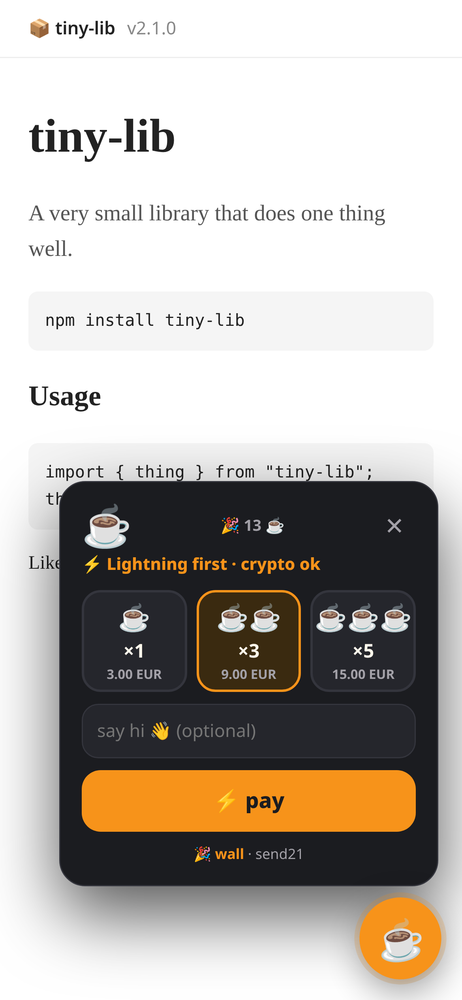
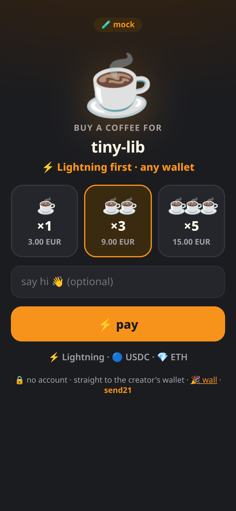
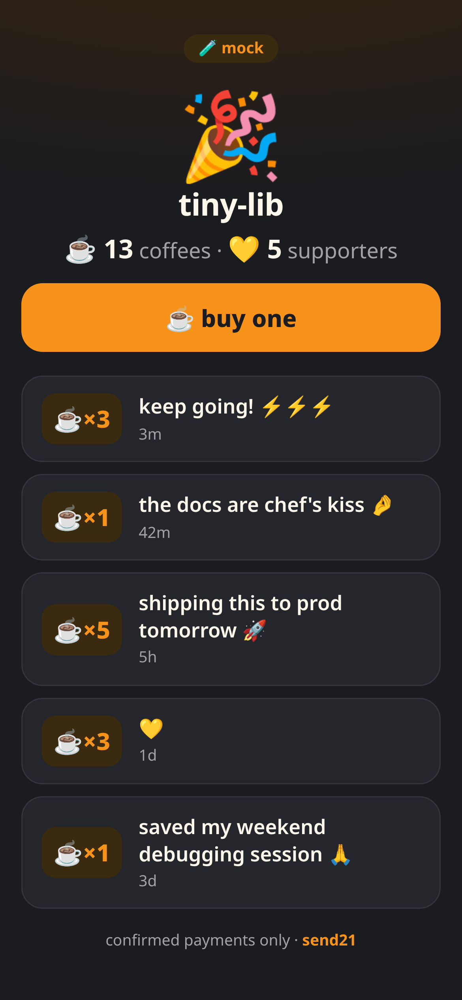
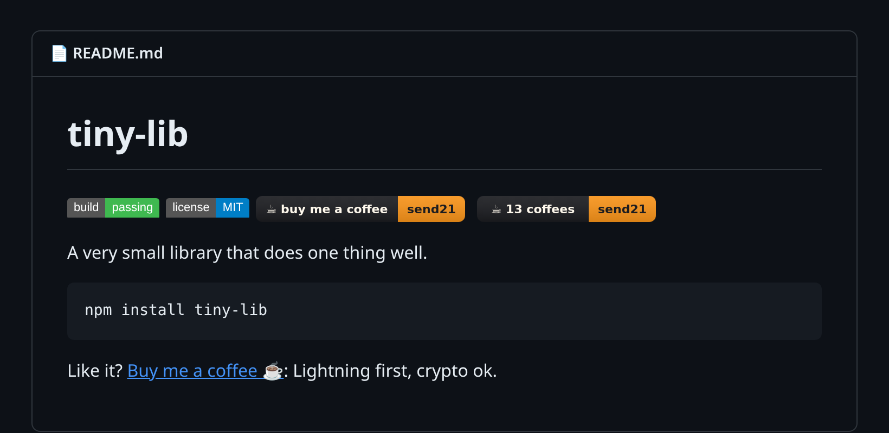
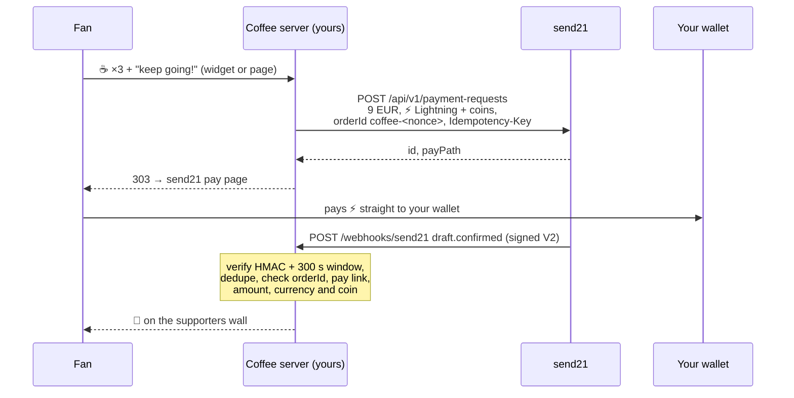

# send21 coffee button ☕

**A "buy me a coffee" for creators and maintainers. Lightning first, crypto ok, self-hosted, one script tag.** Built on [send21](https://send21.io), crypto pay links and API for people and AI agents.

<p>
  
  
  
</p>
<p></p>

<sub>Mock-mode screenshots, not real payments.</sub>

- ⚡ Fans tap ☕ ×1, ×3 or ×5, say hi, and pay over **BTC Lightning**, or USDC, USDT, EURC, SOL, ETH, on-chain BTC, whichever you add
- 🔒 Non-custodial: the money goes from the fan's wallet straight to yours
- 🎉 A public supporters wall, filled only by verified, confirmed payments

## Quickstart

1. **Try it now, no key:** `npm install && npm run dev`, then open http://localhost:3000/demo. Mock mode: tap ☕, pay on the mock page with ✅ (or try ⚠️ short → 👍 accept / ↩️ decline, ⌛ expire) and watch the 🎉 wall.
2. **send21 key.** On [send21.io/api-keys](https://send21.io/api-keys), create a key with `drafts:write` (add `webhooks:manage` for step 4).
3. **Configure.** `cp .env.example .env`: your key, `PUBLIC_URL`, `CREATOR_NAME`, `COFFEE_PRICE` + `COFFEE_CURRENCY` (say 3 EUR) and your receiving addresses: `PAY_LIGHTNING=you@your-wallet.com` and optional extras like `PAY_OPTIONS=usdc-sol:<address>`.
4. **Webhook.** Put the app behind your own HTTPS address (for example a reverse proxy with a free Let's Encrypt certificate, and `TRUST_PROXY=1`), then run `npm run webhook:register` and paste the printed `SEND21_WEBHOOK_SECRET` into `.env`.
5. **Run and embed.** `npm run build && npm start`, then paste a snippet below.

## Embed

**Floating button + popup** (any website, one line):

```html
<script src="https://coffee.example.com/widget.js" async></script>
```

Options: `data-position="left"`, `data-label="☕"`. It lives in a shadow root, so your CSS and its CSS never collide. Open it from your own button with `send21Coffee.open()`. If your site has a strict CSP, allow the origin in `script-src`, `connect-src` and `form-action`.

**README badge** (links to your coffee page):

```markdown
[](https://coffee.example.com/)
```

Live counter variant: `https://coffee.example.com/badge.svg?count` → `☕ 13 coffees | send21`. Wall: `https://coffee.example.com/wall`, JSON: `/api/wall`.

## How it works

A fan picks a size and an optional message (plain text, 80 characters, no links). The coffee page or the widget posts it to your server with a random 20-character nonce. Your server creates one send21 **payment request**: a pay link priced in fiat (cups × `COFFEE_PRICE`), offering your Lightning address first and your other coins after, with `orderId` `coffee-<nonce>` sent as the Idempotency-Key too. A double tap returns the same link, never a second one. The fan is redirected (303) to the send21 pay page, picks a coin (the rate locks for 15 minutes) and pays from their own wallet. The message stays on your server; send21 only sees `☕ ×3 for <creator>`.



| Webhook | Order | On the wall? |
| --- | --- | --- |
| `draft.seen` | 👀 seen | no |
| `draft.confirmed`, matches the order | ✅ paid | **yes** |
| `draft.confirmed`, does **not** match | 🚩 flagged | never |
| `draft.amount_mismatch` → `mismatch_accepted` / `rejected` / `unresolved` | ⚠️ review → 👍 / ↩️ / ⚠️ | only after a matching `draft.confirmed` |
| `payment_request.expired`, `draft.expired` | ⌛ expired (a late confirmed payment still counts) | no |

Payments up to `COFFEE_SHORTFALL_PERCENT` (default 2%) short are accepted through send21's `shortfallPolicy`; other different amounts wait for you to accept or decline them on send21. Hide a note with `npm run wall:hide -- <order id>` (it still counts); hide all amounts or messages with `WALL_SHOW_AMOUNTS` / `WALL_SHOW_MESSAGES`. Amounts are hidden by default.

**⚡ Lightning.** send21 fetches a fresh invoice from your Lightning address for the exact amount and confirms the payment when your wallet provider supports **LUD-21**. Use a provider with LUD-21: without it, the fan's payment still reaches you, but send21 cannot confirm it on its own, so it won't reach the wall. See [Lightning](https://send21.io/docs/lightning).

**Fees.** One small send21 fee per paid coffee (0.49% on small payments, at least $0.01), never taken from the payment. See [pricing](https://send21.io/pricing).

## Security notes

- **Signature V2 only.** Every delivery is checked with `X-Send21-Signature-V2`: HMAC-SHA256 over `<t>.<delivery id>.<raw body>`, constant-time compare, refused when more than **300 s** old or in the future. A bad signature gets `401` and nothing is stored.
- **Dedupe on both sides.** send21 dedupes on its side (retries reuse the same `X-Send21-Delivery` id, and one pay link is one payment). The receiver still runs its own duplicate check: a delivery id, or the same event body under a new id, is applied once. The delivery id and the wall update are written together before the `2xx`, so a restart cannot apply it twice. A failed write answers `500` so send21 retries.
- **Checked against the stored order.** A `draft.confirmed` must match that order exactly: `orderId`, pay link id, fiat currency, the exact amount for its cups (integer cents), a coin and network you offered, a txId and `status: Confirmed`. Anything else is 🚩 and never shows up. Paid is final; late or out-of-order events never undo it. Other apps' orders on the same send21 account are ignored.
- **Wall = confirmed payments only.** Notes are plain text: no links, no markup, no hidden or bidi characters, max 80, escaped on output. Amounts are off by default.
- **Hardened server.** Strict CSP (`'self'` only, no inline script or style) and `frame-ancestors 'none'` on every page, no `innerHTML` in the widget, tiny body limits, pay link creation rate-limited per IP (429 + Retry-After). The widget, badge and `/api/wall` are public by design and served cross-origin; everything else is same-origin. The API key stays on the server and is never logged; a send21 key cannot move funds anyway.
- **Your addresses only.** Addresses are shape-checked per network; anything that looks like a seed phrase or private key is refused. send21 never asks for one.
- **Data.** One JSON file (`DATA_FILE`, mode 600). For several processes, use SQLite or Postgres.

## Develop

```bash
npm run check   # typecheck + lint + tests (signature, dedupe, order matching, idempotency, wall, badge, API)
```

API reference: [send21.io/docs](https://send21.io/docs) · [quickstart](https://send21.io/docs/quickstart) · [webhooks](https://send21.io/docs/webhooks) · [llms-full.txt](https://send21.io/llms-full.txt). More examples: [send21-examples](https://github.com/send21io/send21-examples).

Questions: [info@send21.io](mailto:info@send21.io). License: [MIT](LICENSE).
